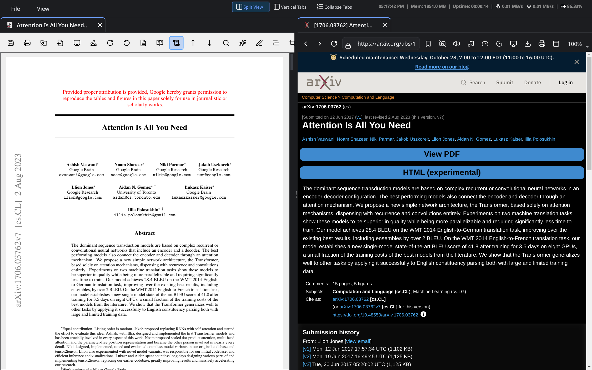
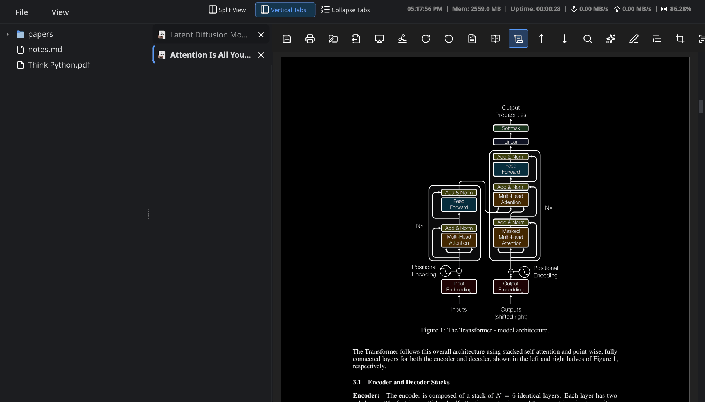
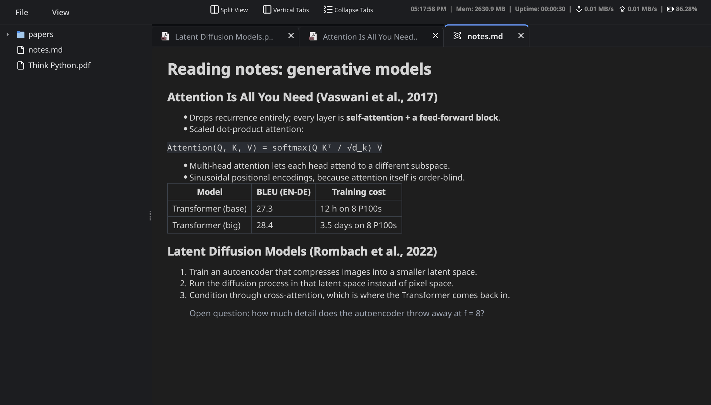
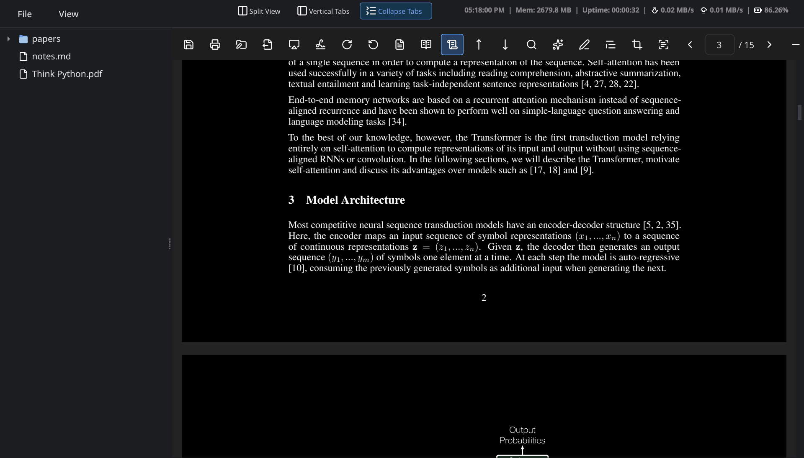
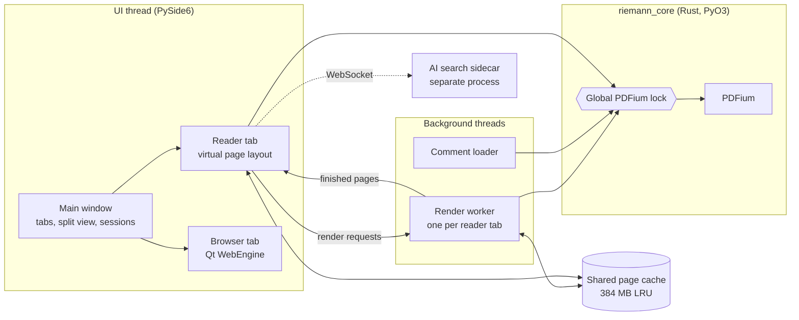

# Riemann

Riemann is a desktop PDF reader and web browser in one window. PDFs, Markdown files and web pages open as tabs. Two tabs can sit side by side, so a paper and the page it came from share one screen. The interface is Python with PySide6 (Qt 6). Rendering, text extraction, search and annotation reading run in a Rust extension built on PDFium, Google's PDF engine.

It runs on Linux and Windows. Version 5.2.1, MIT licensed.



On the test machine (numbers and method under [Performance](#performance)):

- The page in the middle of the screen stays sharp while scrolling at 6,000 px/s, about three pages a second. The version before the rendering rewrite showed a blank page there 92% of the time.
- The 756-page PDF specification shows its first sharp page about 2.0 s after launch, down from 3.9 s.
- Ten open PDFs take 1.8 GB instead of 3.5 GB.
- At 3x zoom the Rust core renders a page 1.5 to 3.5 times faster than it did. It extracts text and searches about as fast as PyMuPDF.

## What it does

### Reading PDFs

- Continuous or single-page scrolling, facing pages, and Auto Fit, Fit Width, Fit Height or manual zoom. Changing the zoom keeps the same spot of the same page in view.
- Pages render on a background thread into a shared memory cache. A quick low-resolution pass fills a page first and the sharp version replaces it a moment later, so fast scrolling (including middle-click autoscroll) shows pages instead of blank space.
- Internal links (table of contents entries, cross-references, citations) jump to the exact spot they point at. External links open in a browser tab with Ctrl+click.
- Select text with the mouse: drag, double-click for a word, triple-click for a line. Or use the keyboard: Shift+arrow keys extend the selection by a character or a line, Ctrl+Shift+Left/Right by a word, and Shift+Home/End to the line edges. Ctrl+C copies.
- Three page themes: light, fast dark (inverted) and smart dark (inverts lightness, keeps hues, so figures stay readable).
- Text reflow mode, find in page, OCR of the current page, and snipping an equation to LaTeX (needs the optional Pix2Tex modules).
- Annotations: sticky notes, text labels, pen, highlighter, text highlight, underline and strikeout, rectangles, ovals, tick and cross stamps, with undo and redo. Notes export to Markdown. Comments left in Acrobat, Preview or Okular show up too.
- Digital signatures: a signed PDF shows a banner on open, a side panel shows the validation result, and you can sign a document with a PKCS#12 certificate.
- Password-protected PDFs open after a prompt, and "Lock | Save" writes an encrypted copy.
- Rotation, printing, saving a copy, renaming a file from its metadata, copying a BibTeX citation, and opening the file in another application.
- AI semantic search (Ctrl+I) finds passages by meaning. It runs a local sidecar process with a small sentence-embedding model; nothing leaves your machine.

### Browsing

- A Chromium-based browser (Qt WebEngine) with a persistent profile, bookmarks, history, autocomplete, a download manager and incognito windows.
- Per-page dark mode, an ad skipper, a video speed controller and an "audiophile" music mode.
- Live captions translated to English (needs faster-whisper), saving a page to PDF, and downloading or streaming video through yt-dlp.
- A mini player in the menu bar controls whatever tab is playing media.

### Folders and preview mode

Open a folder (Ctrl+K, Ctrl+O, or "Open with Riemann" on a folder in your file manager) and it appears as a file tree on the left. A single click shows a file in a temporary preview tab that the next click replaces; a double click opens it for good. Favourite and recent folders are listed on the Workspaces dashboard (Ctrl+Shift+E).



Turn on Settings > "Open Documents in Preview Mode" and every document opens as a lightweight preview, however it was opened. A preview PDF has no toolbar and skips annotations, signature checks, AI indexing and metadata extraction. Markdown is rendered and HTML is shown without running scripts, both without starting Chromium. Double-click a preview tab's title (or right-click it and choose "Open in Full Mode") to switch to the full reader or browser at the same page.



### Layout

- Split view shows two tabs side by side: the "Split View" button in the menu bar, Ctrl+\\, or right-click a tab and choose "Move to Other Pane". You can also drag a tab onto the other pane, or out of the window to give it a window of its own.
- Vertical tabs put the main tab strip in a column on the left ("Vertical Tabs" button, the View menu or Settings).
- "Collapse Tabs" (button, View menu or Ctrl+Shift+B) hides the tab row, or the tab column with vertical tabs, to give the page the room. Ctrl+Tab still switches tabs.
- Edge snapping: drag the window until the pointer touches a screen edge. Left or right gives that half of the screen, the bottom edge the bottom half, the middle of the top edge maximises, and the top corners give the top half. A translucent preview shows the target first. See the Wayland note under [Known limitations](#known-limitations).
- Three-step fullscreen (F11 or F): reading mode with toolbars, then pure fullscreen, then back.
- When a pane is too narrow for the reader toolbar, the toolbar scrolls sideways with the mouse wheel instead of squeezing its buttons.
- Light and dark interface themes (Ctrl+D). The PDF start page, the browser homepage and the Workspaces dashboard share one palette and follow the theme.



### Other tools

Split and merge PDFs, convert PDFs to images, text, Markdown or HTML, and compress PDFs and images. Generate captions for local media. Search your library by keyword or by tags such as `author:Smith year:2024` (Ctrl+L).

### Sessions

Open tabs, split panes, the folder session and each PDF's page are saved every few seconds and shortly after you open or switch tabs. If Riemann closes uncleanly it offers to restore them on the next start, and File > "Restore Last Opened Tabs" brings back the last session at any time. Ctrl+Shift+T reopens the last closed tab.

## How it works



The parts that took the most work:

- **One lock around PDFium, no Python lock held.** PDFium is not thread-safe, so every call into it takes a single process-wide mutex. Every Rust method also releases Python's GIL before taking that mutex. A page can render on a worker thread while the UI thread keeps handling input. No thread ever holds one lock while waiting for the other in the wrong order.
- **Rendering without copies.** The core reads the page size from the page tree and allocates an uninitialised Python `bytes` object of exactly that size. Then it releases the GIL and lets PDFium draw straight into it, in PDFium's native BGRA byte order. That order is Qt's RGB32 layout, the format Qt uses for on-screen pixmaps, so the image reaches the screen without a conversion. The old path copied each page out of PDFium and again into Python. It swapped every pixel's red and blue, and then Qt converted the image once more.
- **A render queue that follows the viewport.** Each reader tab has a worker thread with a queue keyed by page. It always takes the job nearest the page on screen, and low-resolution passes (a quarter of full resolution) before sharp ones. Jobs for a zoom level that is no longer current are dropped. Finished pages go into an LRU cache with a 384 MB budget shared by all tabs, so scrolling back or switching tabs does not render again.
- **A virtual layout for long documents.** Documents over 15 pages only get widgets for the 8 pages before and 16 after the current one; spacers stand in for the rest. Scroll handling is throttled to every 40 ms.
- **Nothing slow on the UI thread.** Reading comments made in other applications and counting signatures used to parse the whole file in pure Python on the UI thread. On the PDF spec that took about 2 s and 0.7 s. Both now go through PDFium, and comments load on a worker thread.
- **Memory that goes back to the OS.** A page at Fit Width is about 10 MB. On Linux, glibc moves allocations that size off `mmap` and into per-thread heaps after the first free, and memory freed there mostly stays with the process. The app pins the threshold at 1 MB with `mallopt`, which halved memory use with many tabs open.

The developer guide in [DevGuide.md](DevGuide.md) covers the internals in more depth.

## Performance

Measured on 2026-10-25 on an Intel Core i5-13500H (16 logical cores, 13 GB RAM), Rocky Linux 10.2, Python 3.11.16, PySide6 6.10.1, PyMuPDF 1.28.2. "Before" is commit `a2d54af` with its own build of the Rust core; "now" is this version. The scripts, the four public test PDFs and the raw JSON results are in [`benchmarks/`](../benchmarks/README.md).

### Scrolling

A reader tab in a 1400x1000 window at Fit Width (pages render at about 2.2x), scrolled at a fixed speed with 60 ticks a second for 5 seconds. "Sharp" is how often the page in the middle of the viewport was fully rendered when checked after a tick. "Longest freeze" is the longest single pass of the Qt event loop, the longest the window could not respond.

| Document | Speed | Sharp, before | Sharp, now | Longest freeze, before | Longest freeze, now | Sharp after stopping, before | Sharp after stopping, now |
| --- | --- | --- | --- | --- | --- | --- | --- |
| PDF 1.7 spec (756 pages) | 2,000 px/s | 24% | 100% | 74 ms | 19 ms | 215 ms | 2 ms |
| | 6,000 px/s | 8% | 100% | 91 ms | 40 ms | 231 ms | 2 ms |
| | 19,000 px/s | 2% | 100% | 131 ms | 38 ms | 271 ms | 2 ms |
| Latent Diffusion paper (45 pages, image-heavy) | 2,000 px/s | 21% | 100% | 200 ms | 15 ms | 334 ms | 2 ms |
| | 6,000 px/s | 7% | 100% | 103 ms | 37 ms | 244 ms | 2 ms |
| | 19,000 px/s | 2% | 50% | 343 ms | 51 ms | 484 ms | 263 ms |

Before, pages only rendered once scrolling paused, and each render ran on the UI thread. At 19,000 px/s (about ten pages a second) the image-heavy paper still outruns the renderer, because decoding its images takes longer than a page stays on screen. There the middle page is a low-resolution stand-in 19% of the time and blank 32% of the time.

The time from opening a document in a reader tab to a sharp first page went from 1.84 s to 0.19 s for the PDF spec. For the Latent Diffusion paper it went from 0.48 s to 0.35 s.

### Startup and memory

Launching the full app with the PDF spec on the command line, median of 5 launches:

| | Before | Now |
| --- | --- | --- |
| Window shown | 1.89 s | 1.78 s |
| First page sharp | 3.87 s | 1.96 s |
| Memory at that point | 386 MB | 296 MB |
| First launch ever, first page sharp | 9.7 s | 7.2 s |

The first launch is slower because it creates the private virtual environment for optional dependencies. Run-to-run variation is about 0.3 s.

Memory with 1, 5 and 10 PDF tabs open, after paging through 60 pages in each. The comparison is with commit `4f65f07`, the first version with the shared page cache:

| Tabs | `4f65f07` | Now | Page cache |
| --- | --- | --- | --- |
| 1 | 399 MB | 339 MB | 135 MB |
| 5 | 2,192 MB | 1,060 MB | 381 MB |
| 10 | 3,515 MB | 1,759 MB | 378 MB |

The cache stays within its 384 MB budget. The rest grows by roughly 140 MB per tab. PDFium keeps about 23 MB of state per open document, and each tab holds rendered images for the pages it is showing.

### The PDF engine

Median time to render one page, sampled across each document, before and now, with PyMuPDF (MuPDF) on the same pages for reference. 1x is 72 DPI; 3x is 216 DPI, roughly a 1.5x-scaled screen at Fit Width.

| Document | 1x before | 1x now | 3x before | 3x now | 3x PyMuPDF |
| --- | --- | --- | --- | --- | --- |
| Attention Is All You Need (15 pages) | 4.4 ms | 4.0 ms | 28.7 ms | 14.4 ms | 6.5 ms |
| Latent Diffusion (45 pages, images) | 26.7 ms | 27.0 ms | 66.2 ms | 44.7 ms | 20.1 ms |
| Think Python (244 pages) | 2.8 ms | 1.9 ms | 25.2 ms | 7.1 ms | 3.7 ms |
| PDF 1.7 spec (756 pages) | 4.7 ms | 3.7 ms | 30.8 ms | 11.6 ms | 6.2 ms |

| Document | Open, Riemann | Open, PyMuPDF | Text, Riemann | Text, PyMuPDF | Search, Riemann | Search, PyMuPDF |
| --- | --- | --- | --- | --- | --- | --- |
| Attention | 0.8 ms | 1.2 ms | 310 pages/s | 276 pages/s | 47 ms | 62 ms |
| Latent Diffusion | 0.3 ms | 2.2 ms | 644 pages/s | 555 pages/s | 64 ms | 91 ms |
| Think Python | 1.4 ms | 18.1 ms | 858 pages/s | 864 pages/s | 252 ms | 327 ms |
| PDF 1.7 spec | 20.3 ms | 34.6 ms | 446 pages/s | 490 pages/s | 1,568 ms | 1,540 ms |

MuPDF rasterises faster than PDFium, by 1.9 to 2.2 times at 3x on these files. Opening documents, extracting text and searching are on par or faster in Riemann. Search times cover every page of the document.

### Reproducing

```bash
env -u LD_LIBRARY_PATH riemann/bin/python benchmarks/fetch_corpus.py
```

```bash
env -u LD_LIBRARY_PATH riemann/bin/python benchmarks/bench_scroll.py
```

The other scripts (`bench_core.py`, `bench_startup.py`, `bench_memory.py`) run the same way. Each writes a JSON file to `benchmarks/results/` with the machine details and settings next to the numbers.

## Project in numbers

| | |
| --- | --- |
| Python (app) | 19,400 lines in 30 files |
| Python (tests) | 3,600 lines, 200 tests |
| Rust (core and OCR worker) | 1,050 lines |
| JavaScript (injected browser scripts, homepage) | 1,500 lines |
| Benchmarks | 790 lines of Python |
| Test coverage | 48.5% of 10,417 statements |
| History | 217 commits since January 2026 |

## Keyboard shortcuts

| Keys | Action |
| --- | --- |
| Ctrl+O | Open files |
| Ctrl+T / Ctrl+B | New PDF tab / new browser tab |
| Ctrl+W, Ctrl+Shift+T | Close tab, reopen last closed tab |
| Ctrl+Tab, Ctrl+Shift+Tab | Next / previous tab |
| Ctrl+\\ | Toggle split view |
| Ctrl+Shift+B | Collapse or expand the tab strip |
| Ctrl+N, Ctrl+Shift+N | New window, new incognito window |
| Ctrl+K, Ctrl+O / Ctrl+K, F | Open folder / close folder session |
| Ctrl+H, Ctrl+J, Ctrl+K K | History, downloads, bookmarks |
| Ctrl+, | Settings |
| Ctrl+D | Toggle the interface theme |
| N | Toggle the current tab's page theme |
| F11 or F | Cycle fullscreen modes |
| A / W / H | Auto Fit / Fit Width / Fit Height |
| Ctrl+= / Ctrl+- / Ctrl+wheel | Zoom |
| R / C / D | Reflow mode / continuous scroll / facing pages |
| Left / Right, Page Up / Page Down, Space | Previous / next page, scroll by a page or a screen |
| Shift+arrows, Ctrl+Shift+Left/Right, Shift+Home/End | Extend the text selection |
| Ctrl+F / Ctrl+I | Find / AI search |
| Ctrl+Shift+A | Annotation tools |
| Ctrl+R / Ctrl+Shift+R | Rotate clockwise / counter-clockwise |
| Ctrl+P, Ctrl+Shift+S, F5 | Print, save an encrypted copy, reload from disk |

In a browser tab, F5 and Ctrl+R reload and Ctrl+Shift+R reloads without the cache. Ctrl+M toggles music mode, Ctrl+G the video controller, and F12 opens the developer tools.

## Running from source

You need Python 3.11, a Rust toolchain, and the PDFium library. Linux and Windows builds of PDFium are in `libs/`, and a copy of `libpdfium.so` sits in the repository root, where the Rust core looks for it when you run from there.

```bash
uv venv riemann --python 3.11
```

```bash
source riemann/bin/activate
```

```bash
uv pip install -e ".[dev]"
```

`pip install -e .` builds the Rust extension with maturin. After changing `rust-core/`, rebuild it with:

```bash
maturin develop --release
```

Then start the app from the repository root:

```bash
env -u LD_LIBRARY_PATH PYTHONPATH=python-app riemann/bin/python -m riemann
```

`just run` does the same after rebuilding the extension. Pass files or folders on the command line to open them, and `--new-window` to start a separate instance instead of handing them to the one already running.

Heavy features install on demand: Settings > "Manage External Dependencies" puts PyMuPDF, PyTorch, Pix2Tex, yt-dlp, Pygments, faster-whisper and a few others into a private virtual environment under the app's data directory. The AI search sidecar is a separate conda environment packed into `python-app/riemann/assets/riemann_ai_engine` by `riemann-ai/build_ai.sh`.

## Building a standalone executable

- `scripts/nbuild.sh` compiles a single-file Linux binary with Nuitka and writes it to `dist/Riemann`.
- `scripts/build.sh` builds with PyInstaller using `Riemann.spec`.
- `.github/workflows/release.yml` builds the Windows release on GitHub Actions.

On Linux, the packaged binary adds itself to the applications menu the first time it runs. The entry registers PDFs, Markdown, HTML and folders, so Riemann shows up under "Open With" in the file manager. `scripts/install_icon.sh` writes the same entry by hand.

## Tests

```bash
env -u LD_LIBRARY_PATH PYTHONPATH=python-app QT_QPA_PLATFORM=offscreen riemann/bin/python -m pytest python-app/tests
```

`scripts/test_runner.sh` also runs the Rust tests (`cargo test`) and the JavaScript tests for the injected browser scripts (`npm test`). For coverage, point pytest-cov at the source folder (`--cov=python-app/riemann`); `--cov=riemann` matches the virtual environment folder of the same name instead.

## Project layout

```text
python-app/riemann/
  app.py              main window: tabs, split view, sessions, menus, shortcuts
  core/               managers (history, bookmarks, downloads, library), captions,
                      conversion and compression, optional dependencies, window snapping
  ui/browser.py       browser tab and the lightweight Markdown/HTML/text preview
  ui/reader/          PDF reader: tab.py, background renderer, mixins for rendering,
                      annotations, search, signatures, metadata and AI search
  ui/explorer.py      folder tree and the Workspaces dashboard
  assets/             icons, themes, homepage, injected browser scripts
rust-core/            PyO3 extension wrapping PDFium (rendering, text, links, forms,
                      comments, signatures)
rust-ocr-worker/      OCR used by the core
riemann-ai/           local semantic-search sidecar (FastAPI, FAISS)
benchmarks/           benchmark scripts, corpus list and results
scripts/              build, packaging and test scripts
docs/                 this file, the developer guide, the directory tree, screenshots
```

## Known limitations

- Wayland does not let applications place their own windows, so edge snapping can't work in a native Wayland window. On a Wayland session it is off by default. Turning it on in Settings makes Riemann run through XWayland after a restart. With fractional display scaling, XWayland windows can look slightly soft unless your compositor scales them natively (GNOME has an experimental `xwayland-native-scaling` option for this). GNOME's own Super+Left, Super+Right and Super+Up still tile the native window.
- PDFium rasterises image-heavy pages about twice as slowly as MuPDF, so very fast scrolling through scanned or photo-heavy documents can briefly show low-resolution pages.
- Keyboard selection works within one page at a time.
- Code previews are syntax-highlighted only when Pygments is installed (it is left out of the Nuitka build; add it from "Manage External Dependencies").

## License

MIT. See `LICENSE`.
