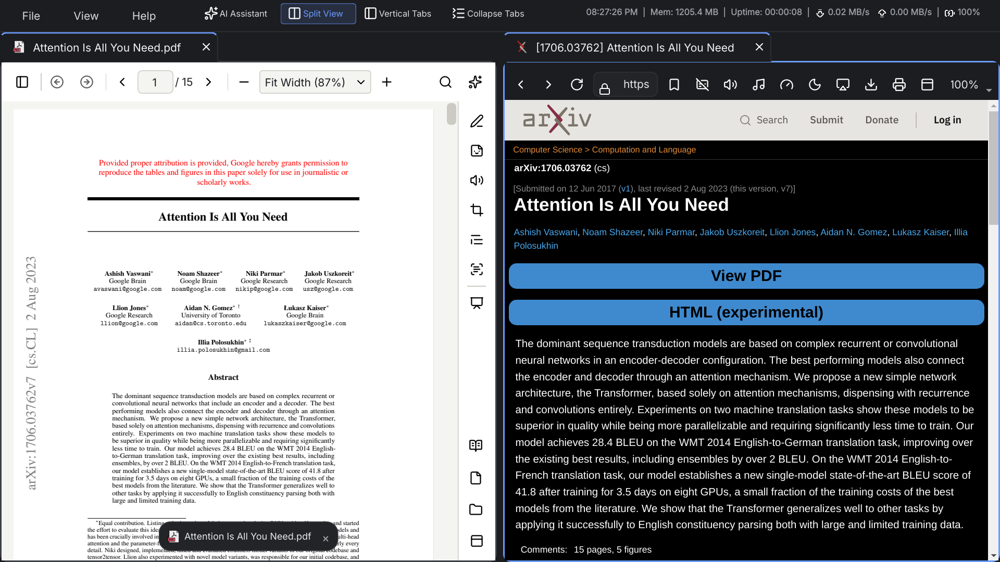
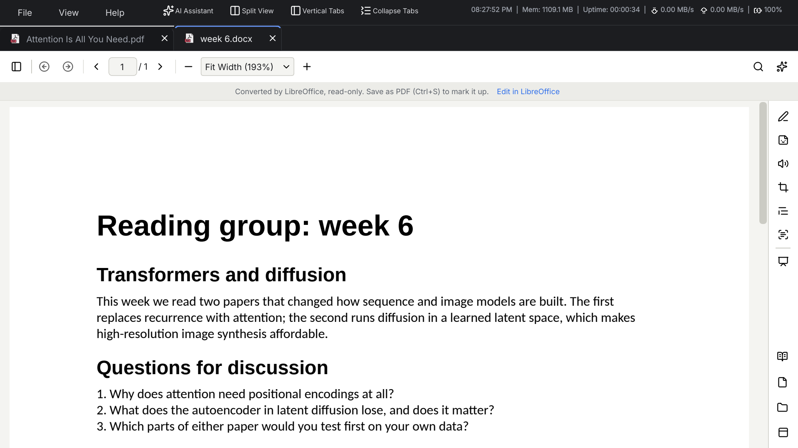
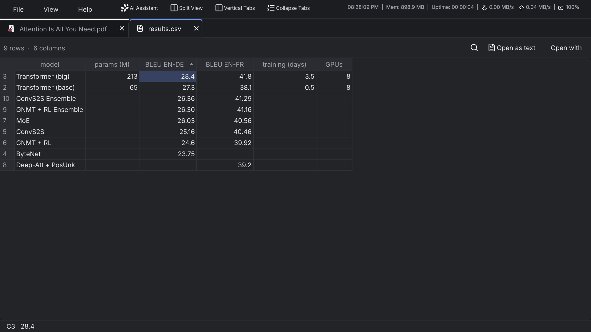
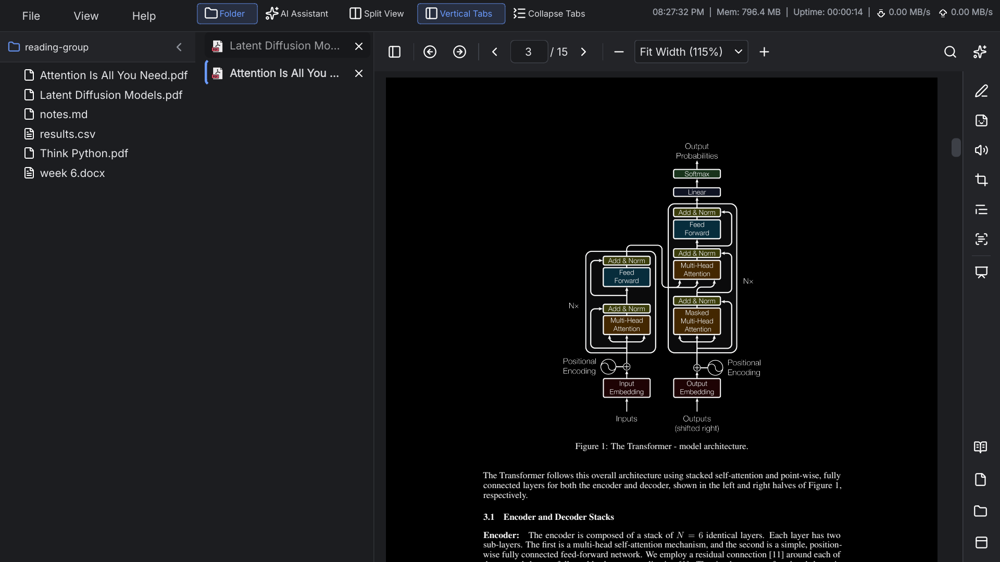
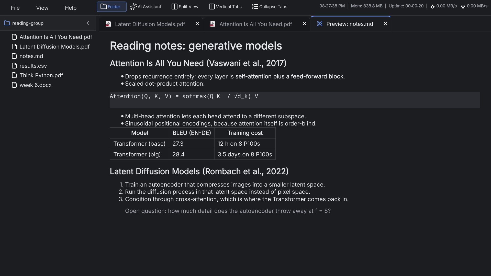
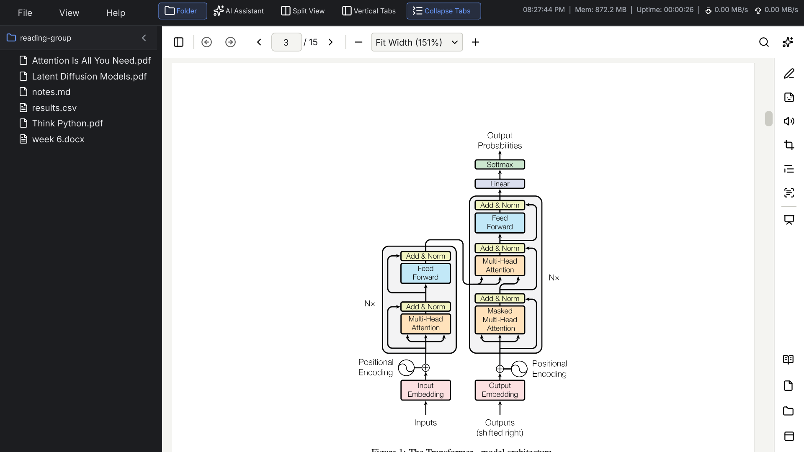
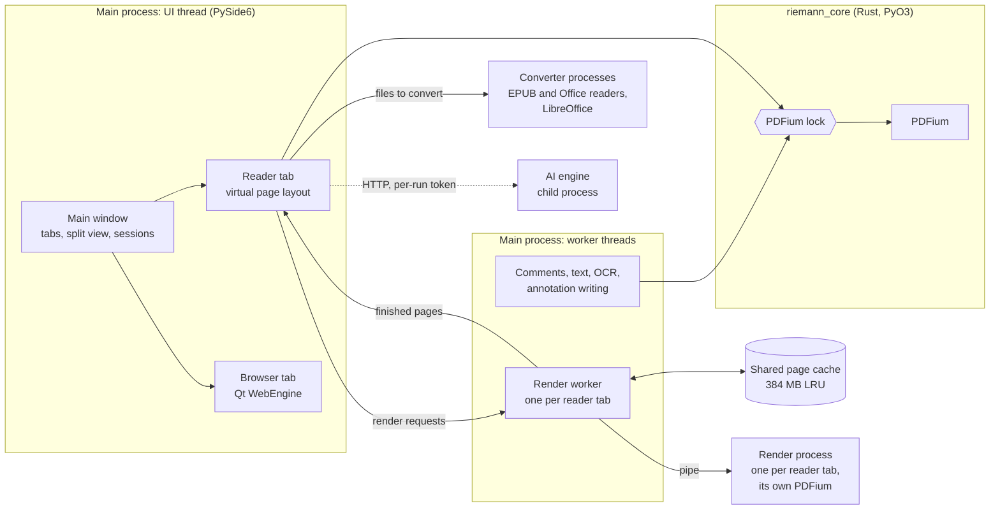

# Riemann

Riemann is a desktop document reader and web browser in one window. PDFs, Word, PowerPoint and Excel files, OpenDocument files, EPUB books, Markdown, CSV tables, pictures, plain text, source code and web pages open as tabs. Two tabs can sit side by side, so a paper and the page it came from share one screen. The interface is Python with PySide6 (Qt 6). Rendering, text extraction, search and annotation reading run in a Rust extension built on PDFium, Google's PDF engine.

It runs on Linux and Windows. Version 7.3.0, MIT licensed.



On the test machine (numbers and method under [Performance](#performance)):

- The page in the middle of the screen stays sharp while scrolling the 756-page PDF specification at 19,000 px/s, about ten pages a second, and the window never stops responding for more than 26 ms.
- The PDF specification shows its first sharp page about 1.0 s after launch.
- Ten open PDFs take 2,070 MB, counting the render process each tab runs.
- Applying redactions to the 756-page specification takes 4.2 s, most of it writing the file out again.

## What it does

### Reading PDFs

- Continuous or single-page scrolling, facing pages, and Auto Fit, Fit Width, Fit Height or manual zoom. Changing the zoom keeps the same spot of the same page in view.
- Each reader tab renders its pages in a child process of its own, so a slow page in one tab doesn't hold up the others. A quick low-resolution pass fills a page first and the sharp version replaces it a moment later, so fast scrolling (including middle-click autoscroll) shows pages instead of blank space.
- Internal links (table of contents entries, cross-references, citations) jump to the exact spot they point at, and Alt+Left and Alt+Right go back and forward. Resting the pointer on a citation shows the reference it points to. External links open in a browser tab with Ctrl+click.
- A sidebar (Ctrl+Alt+S) lists the document's sections and its page thumbnails. Click either to jump there; the current section and page stay highlighted as you scroll.
- Select text with the mouse: drag, double-click for a word, triple-click for a line. Or use the keyboard: Shift+arrow keys extend the selection by a character or a line, Ctrl+Shift+Left/Right by a word, and Shift+Home/End to the line edges. Selection follows PDFium's own glyph boxes, and a letter joins the selection once the pointer passes its middle.
- Three page themes (N): light, fast dark (inverted) and smart dark, which inverts lightness and keeps hues, so figures stay readable.
- Text reflow mode, find in page, OCR of the current page or a range of pages, and snipping an equation to LaTeX (needs the optional Pix2Tex component).
- Notes per paper (Ctrl+Alt+N): a Markdown file kept next to the PDF, shown in a panel with an editor and a preview. "Link this page" inserts a link that jumps back to the page.
- Read aloud (Ctrl+Shift+U) speaks the document with the system's text-to-speech voice. The word being spoken is highlighted within its sentence, and pages turn as it goes.
- Presentation mode (Shift+F5): one page at a time on black, with a laser pointer (L), blank screens (B and W), zoom around the pointer, and the next page rendered ahead.
- AI semantic search (Ctrl+I) finds passages by meaning. It runs a small sentence-embedding model in a child process of the app; nothing leaves your machine. Password-protected files work too.

### Editing PDFs

- Annotations: sticky notes, text labels, pen, highlighter, text highlight, underline and strikeout, rectangles, ovals, tick and cross stamps, with undo and redo. Notes export to Markdown. Comments left in Acrobat, Preview or Okular show up too.
- Annotations are saved inside the PDF as standard PDF annotations, so Acrobat, Preview, Okular and browsers show them, and text edited there comes back to Riemann. The file is changed the way other editors do it (an incremental update appended to the end), which keeps it valid while open and leaves existing signatures intact. Signed, encrypted and read-only files keep their annotations in Riemann only; Settings > "Save Annotations Inside PDF Files" turns this off.
- Forms: fill in a PDF's fields in place; entries are saved into the file.
- Pages: rotate, delete, move and extract pages, and insert another PDF, from the Pages menu or the thumbnails. Edits go into a private copy and the file on disk changes only when you save; Discard puts everything back.
- Redaction: mark text with "Mark for Redaction" in the right-click menu, or drag a box with the Redact tool, then press "Apply redactions". What lies under each mark is removed from the file itself: text glyph by glyph, images pixel by pixel, and links, comments and form fields that touch it. The rest of the page keeps its exact layout. The result is checked before it replaces the file, and if a page can't be redacted exactly, nothing changes and Riemann names the page.
- Replace text: select words and choose "Replace Text…" to draw new text over them, in the closest standard font, size and colour, on the page's own background colour. Tick "Remove the original text too" to redact the old words when you apply redactions.
- Passwords: Ctrl+Shift+S saves a password-protected copy. On a PDF that has a password, the same button removes it, either from the file itself (on Save) or into an unlocked copy. Page edits keep a file's password.
- Digital signatures: a signed PDF shows a banner on open, a side panel shows the validation result, and you can sign a document with a PKCS#12 certificate. After "Verify Signatures", fields drawn by Acrobat-style signers show a green tick (valid and trusted) or a red cross (invalid) in place of the stored question mark. A signed file can still be edited, after a warning that editing breaks its signatures.
- Rotation, printing, saving a copy with its annotations (Ctrl+S), renaming a file from its metadata, copying a BibTeX citation, and opening the file in another application.

### Text, Markdown and code

Markdown files open rendered, with maths typeset by KaTeX. Plain text and source files open in the same reader, highlighted when the optional Pygments component is installed. Riemann treats any file that looks like UTF-8 text as text, so logs, `Makefile` and files without an extension open too. HTML files open in the browser. Any other file opens as its bytes, read-only, in a hex view. Riemann never runs a file: programs get a warning and no "Open with".

### Office files

- Word, PowerPoint, OpenDocument and RTF files open as pages, the way they print, when LibreOffice is installed. Riemann converts them to PDF in the background with a locked-down LibreOffice profile of its own. No macros run and no pictures are fetched from the web, so opening a file never tells its sender. Converted copies are cached, so a file opens at once the second time.
- These tabs are read-only. Save as PDF (Ctrl+S) turns one into a PDF you can annotate. "Edit in LibreOffice" opens the file there, and when you save it, the tab reloads on the same page.
- Without LibreOffice, Riemann offers to install it (the distribution's packages through pkexec, then Flatpak, or winget on Windows), showing the commands first and running nothing until you click Install. Or choose the basic view: the text, headings, tables and pictures of a .docx, .pptx, OpenDocument or RTF file, read by Riemann itself, without the page layout.
- Excel and OpenDocument spreadsheets open in the table view, a tab per sheet, with number formats, merged cells and formulas. With LibreOffice the formulas are worked out again first, and "Show as pages" opens the workbook as it prints, charts included.



### Tables, e-books and pictures

- CSV and TSV files open as a table. Riemann finds the separator, the text encoding and the header row, reads a large file as you scroll, sorts by a column (numbers by value), finds text and copies cells. Double-click or F2 changes a cell; Ctrl+S asks before it saves, and the file keeps its separators and encoding.
- EPUB books open as one long page in the reader, with the chapters in the sidebar. The book's own scripts, styles and fonts are left out, and pictures are never loaded from the web.
- Pictures open in a viewer: PNG, JPEG, GIF, WebP, AVIF, TIFF, SVG, Photoshop files and many older formats. It has fit and zoom modes, steps through the pictures in the folder and the pages of a multi-page TIFF, plays moving GIFs, shows transparency on a checkerboard and saves as PDF.



### Browsing

- A Chromium-based browser (Qt WebEngine) with a persistent profile, bookmarks, history, autocomplete, a download manager and incognito windows.
- Per-site permissions in Settings for the camera, microphone, screen sharing, location, notifications, clipboard, autoplay and pop-ups. By default sites ask for capture devices, location, notifications and clipboard reading, and pop-ups are blocked.
- Per-page dark mode, an ad skipper, a video speed controller and an "audiophile" music mode.
- Live captions translated to English (needs faster-whisper), saving a page to PDF, and downloading or streaming video through yt-dlp.
- A mini player in the menu bar controls whatever tab is playing media.
- A page that warns about unsaved changes (a half-written post, say) asks before its tab, its window or the app closes, and before you navigate away.

### Folders and preview mode

Open a folder (Ctrl+K, Ctrl+O, or "Open with Riemann" on a folder in your file manager) and it appears as a file tree on the left. A single click shows a file in a temporary preview tab that the next click replaces; a double click (on the file or on the preview tab's title) opens it for good. A file that is already open is brought to the front instead of opening twice. The tree collapses out of the way without ending the session (the arrow in its header, the "Folder" button or Ctrl+Shift+F). Favourite and recent folders are listed on the Workspaces dashboard (Ctrl+Shift+E).



Turn on Settings > "Open Documents in Preview Mode" and every document opens as a lightweight preview, however it was opened, with an eye on its tab. A preview PDF has no toolbar and skips annotations, signature checks, AI indexing and metadata extraction. Markdown and text are shown, and HTML without running scripts, without starting Chromium. Double-click a preview tab's title (or right-click it and choose "Open in Full Mode") to switch to the full reader or browser at the same page.



"Open in External Application" (File menu, a tab's right-click menu, or right-click in the folder tree) works for documents, web pages (the system browser or any installed browser) and folders (the system file manager, other file managers or VS Code).

### Layout

- Split view shows two tabs side by side: the "Split View" button, Ctrl+\\, or right-click a tab and choose "Move to Other Pane". You can also drag a tab onto the other pane, or out of the window to give it a window of its own.
- Settings, History, Bookmarks, Downloads, Library and Help open as tabs, once each; opening one again brings it forward.
- Help (F1) explains the main features in plain words and lists every keyboard shortcut.
- The command palette (Ctrl+Shift+P) runs any menu command or toolbar button by typing a few letters of its name.
- Reader toolbar layouts, in Settings > Appearance: Default (a short top bar and a side rail, with floating page controls in full screen), A (one bar with menus), B (a bar and a ribbon row), C (a short top bar and a side rail) and D (a short top bar and floating page controls). Custom places each button where you choose.
- AI assistant (Ctrl+Alt+A): ask questions about the open PDF in a panel beside it. Pick a provider (Claude, OpenAI, Gemini, OpenRouter, or a local Ollama server) and any model it offers. Answers cite pages, and clicking a page number jumps there. Add API keys with the key button in the panel, or set ANTHROPIC_API_KEY, OPENAI_API_KEY, GEMINI_API_KEY or OPENROUTER_API_KEY. Saved keys go in `~/.config/Riemann/ai.env` (`%APPDATA%\Riemann\ai.env` on Windows), a file only your user account can read. The document's text (the pages nearest the current one, for long files) is sent to the provider you pick; with Ollama it stays on your machine.
- Vertical tabs put the tab strip in a column on the left, and "Collapse Tabs" (Ctrl+Shift+B) hides it to give the page the room. Ctrl+Tab still switches tabs.
- Edge snapping: drag the window until the pointer touches a screen edge. Left or right gives that half of the screen, the bottom edge the bottom half, the middle of the top edge maximises, and the top corners give the top half. See the Wayland note under [Known limitations](#known-limitations).
- Three-step fullscreen (F11 or F): reading mode with toolbars, then pure fullscreen, then back.
- Light and dark interface themes (Ctrl+D). The reader's start page, the browser homepage and the Workspaces dashboard follow it.



### Accessibility

- Names for screen readers: buttons that show only an icon get the name Orca, NVDA or VoiceOver reads out, taken from their tooltips, with the keyboard shortcut as their description. Every control in the reader and browser toolbars has one.
- Reading ruler (Ctrl+Alt+L): a band over the line you're reading, with the rest of the page dimmed. It follows the mouse, and Alt+Down and Alt+Up move it a line at a time, on to the next or previous page. Two columns stay apart.
- While a document is read aloud, the word being spoken is marked as well as its sentence. Voices that report their place set the mark; for the rest it follows the speaking speed, which Riemann learns as it reads.
- A high-contrast dark theme (Settings > Appearance > High contrast): pure black with white text and brighter outlines, every text colour at least 7:1 on black. On an OLED screen the black pixels are switched off.
- Settings > Accessibility turns the screen-reader names, the word highlight and the reading ruler on and off.

### Other tools

Split and merge PDFs, convert PDFs to images, text, Markdown or HTML, and compress PDFs and images. Generate captions for local media. Search your library by keyword, by tags such as `author:Smith year:2024`, or by meaning across every paper you've opened (Ctrl+L), and export it as BibTeX or CSL-JSON.

### Sessions and history

Open tabs, split panes, the folder session and each document's page are saved every few seconds and shortly after you open or switch tabs. If Riemann closes uncleanly it offers to restore them on the next start, and File > "Restore Last Opened Tabs" brings back the last session at any time. Ctrl+Shift+T reopens the last closed tab.

History (Ctrl+H) lists web pages, documents and folder sessions with the date and time each was last opened. Documents are sorted into PDF, Word, Slides, Spreadsheet, Markdown, E-book, Code, Text and Image, with a filter for each.

## How it works



The parts that took the most work:

- **One lock around PDFium, parallelism from processes.** PDFium is not thread-safe, so within a process every call into it takes a single mutex. Every Rust method releases Python's GIL before taking it. Rendering, the expensive part, runs in a child process per reader tab with its own PDFium. Tabs render in parallel, and the main process's lock stays free for text, links and forms. If a child fails to start or dies, pages render in-process.
- **Rendering without copies.** The core allocates an uninitialised Python `bytes` object of exactly the page's size, releases the GIL and lets PDFium draw straight into it. PDFium's native BGRA order is Qt's RGB32 layout, so the image reaches the screen without a conversion.
- **A render queue that follows the viewport.** Each reader tab has a worker thread with a queue keyed by page. It always takes the job nearest the page on screen, and low-resolution passes (a quarter of full resolution) before sharp ones. Jobs for a zoom level that is no longer current are dropped. Finished pages go into an LRU cache with a 384 MB budget shared by all tabs.
- **Untrusted files in child processes.** EPUB books and Office files are read in a child process with a time limit. A file built to make a parser hang or eat memory only ends that process. LibreOffice runs headless with a profile of Riemann's own, rewritten before each run with macros off and remote content blocked.
- **A virtual layout for long documents.** Documents over 15 pages only get widgets for the 8 pages before and 16 after the current one; spacers stand in for the rest.
- **Edits that can't damage the original.** Page edits, redaction and password removal work on a private copy and replace the file in one rename on Save. Annotations are appended as incremental updates, which leave the original bytes untouched.
- **Redaction that is checked.** The engine interprets each page's content stream to find every glyph, cuts out the marked ones and keeps the spacing they took up, so nothing else moves. Before the result replaces the file, PDFium reads it back: no character may remain under a mark, and every other character must still be in place to within 0.01 pt.
- **Memory that goes back to the OS.** A page at Fit Width is about 10 MB. On Linux, glibc moves allocations that size into per-thread heaps after the first free, and memory freed there mostly stays with the process. The app pins the threshold at 1 MB with `mallopt`.

The developer guide in [DevGuide.md](DevGuide.md) covers the internals in more depth.

## Performance

Measured on 2026-11-17 on an Intel Core i5-13500H (16 logical cores, 13 GB RAM), Rocky Linux 10.2, Python 3.11, PySide6 6.10.1, PyMuPDF 1.28.2, with Qt's offscreen platform. The scripts, the four public test PDFs and the raw JSON results are in [`benchmarks/`](../benchmarks/README.md); this run is labelled `2026-11-17`.

The same machine ran the same PyMuPDF version about 1.7 times faster than when the previous figures were taken (2026-10-25). Earlier numbers can't be compared with these directly. The tables below compare against PyMuPDF from the same run, or against Riemann itself with a feature turned off.

### Scrolling

A reader tab in a 1400x1000 window at Fit Width (pages render at about 2.2x), scrolled at a fixed speed with 60 ticks a second for 5 seconds. "Sharp" is how often the page in the middle of the viewport was fully rendered when checked after a tick. "Longest freeze" is the longest single pass of the Qt event loop, the longest the window could not respond. "In-process" is the same run with `RIEMANN_RENDER_PROCESS=0`, rendering in the main process as before render processes were added.

| Document | Speed | Sharp | Longest freeze | Sharp after stopping | Sharp, in-process | Longest freeze, in-process |
| --- | --- | --- | --- | --- | --- | --- |
| PDF 1.7 spec (756 pages) | 2,000 px/s | 100% | 11 ms | 2 ms | 100% | 10 ms |
| | 6,000 px/s | 100% | 25 ms | 2 ms | 100% | 30 ms |
| | 19,000 px/s | 100% | 26 ms | 2 ms | 100% | 31 ms |
| Latent Diffusion paper (45 pages, image-heavy) | 2,000 px/s | 100% | 9 ms | 2 ms | 100% | 13 ms |
| | 6,000 px/s | 100% | 26 ms | 2 ms | 100% | 25 ms |
| | 19,000 px/s | 66% | 30 ms | 123 ms | 66% | 26 ms |

With one tab, rendering in a child process makes no measurable difference to scrolling: the renderer keeps up either way. Render processes are there for several tabs at once, which then render in parallel instead of queueing for one PDFium lock.

At 19,000 px/s the image-heavy paper still outruns the renderer, because decoding its images takes longer than a page stays on screen. There the middle page is a low-resolution stand-in 11% of the time and blank 25% of the time (15% and 12% in-process). A document opened in a reader tab shows its first sharp page in about 0.3 s (PDF spec) and 0.2 s (Latent Diffusion).

### Startup and memory

Launching the full app with the PDF spec on the command line, median of 7 launches:

| | Median | First launch on empty data folders |
| --- | --- | --- |
| Modules imported | 0.34 s | 0.34 s |
| Window shown | 0.64 s | 0.69 s |
| First page sharp | 1.00 s | 1.01 s |
| Memory, main process | 286 MB | 284 MB |
| Memory, all processes | 304 MB | 301 MB |

A first launch is no slower than any other: the private environment for optional components is created only when one is installed.

Memory with 1, 5 and 10 PDF tabs open, after paging through 60 pages in each. "Main process" is its resident memory; "All processes" adds the render process of each tab, counting memory they share once (proportional set size):

| Tabs | Main process | All processes | Page cache |
| --- | --- | --- | --- |
| 0 (window only) | 120 MB | 111 MB | 0 MB |
| 1 | 301 MB | 328 MB | 126 MB |
| 5 | 1,011 MB | 1,190 MB | 381 MB |
| 10 | 1,679 MB | 2,074 MB | 376 MB |

Each render process adds about 40 MB: its own PDFium and Python. The rest grows by roughly 150 MB per tab. PDFium keeps per-document state in the main process too, for text, links and forms, and each tab holds rendered images for the pages it is showing.

The shared page cache stays within its 384 MB budget.

### The PDF engine

Median time to render one page, sampled across each document, with PyMuPDF (MuPDF) on the same pages for reference. 1x is 72 DPI; 3x is 216 DPI, roughly a 1.5x-scaled screen at Fit Width.

| Document | 1x Riemann | 1x PyMuPDF | 3x Riemann | 3x PyMuPDF |
| --- | --- | --- | --- | --- |
| Attention Is All You Need (15 pages) | 2.0 ms | 1.4 ms | 7.5 ms | 3.6 ms |
| Latent Diffusion (45 pages, images) | 14.7 ms | 2.5 ms | 26.5 ms | 12.1 ms |
| Think Python (244 pages) | 1.1 ms | 0.8 ms | 4.3 ms | 2.4 ms |
| PDF 1.7 spec (756 pages) | 2.1 ms | 1.7 ms | 6.7 ms | 3.7 ms |

| Document | Open, Riemann | Open, PyMuPDF | Text, Riemann | Text, PyMuPDF | Search, Riemann | Search, PyMuPDF |
| --- | --- | --- | --- | --- | --- | --- |
| Attention | 0.4 ms | 0.7 ms | 522 pages/s | 457 pages/s | 28 ms | 35 ms |
| Latent Diffusion | 0.2 ms | 1.1 ms | 1,127 pages/s | 1,021 pages/s | 38 ms | 51 ms |
| Think Python | 0.8 ms | 10.2 ms | 1,542 pages/s | 1,481 pages/s | 146 ms | 189 ms |
| PDF 1.7 spec | 11.7 ms | 19.9 ms | 801 pages/s | 891 pages/s | 900 ms | 842 ms |

MuPDF rasterises faster than PDFium, by 1.8 to 2.2 times at 3x on these files, the same ratio as in October. Opening documents, extracting text and searching are on par or faster in Riemann. Search times cover every page of the document.

### Redaction

Applying redaction marks, including the full save and the PDFium check of the result:

| Document | Time |
| --- | --- |
| Think Python (244 pages) | 0.06 s |
| Latent Diffusion (45 pages, 41 MB of images) | 0.19 s |
| Attention Is All You Need (15 pages) | 0.30 s |
| PDF 1.7 spec (756 pages, 22 MB) | 4.2 s |

Most of the time on the long document goes into writing the whole file out again, which redaction needs so that the removed content doesn't survive in the file.

### Reproducing

```bash
env -u LD_LIBRARY_PATH riemann/bin/python benchmarks/fetch_corpus.py
```

```bash
env -u LD_LIBRARY_PATH riemann/bin/python benchmarks/bench_scroll.py --label mine
```

The other scripts (`bench_core.py`, `bench_startup.py`, `bench_memory.py`) run the same way. Each writes a JSON file to `benchmarks/results/` with the machine details and settings next to the numbers. Use a label of your own, so the stored results aren't overwritten.

## Project in numbers

| | |
| --- | --- |
| Python (app) | 39,500 lines in 117 files |
| Python (tests) | 16,100 lines, 1,345 tests |
| Rust (core and OCR worker) | 2,000 lines, 36 tests |
| JavaScript (injected browser scripts, homepage) | 1,300 lines, plus 240 lines of tests |
| Benchmarks | 850 lines of Python |
| Test coverage | 75% of 24,701 statements |
| History | over 330 commits since January 2026 |

## Keyboard shortcuts

| Keys | Action |
| --- | --- |
| Ctrl+O | Open files |
| Ctrl+T / Ctrl+B | New reader tab / new browser tab |
| Ctrl+W, Ctrl+Shift+T | Close tab, reopen last closed tab |
| Ctrl+Tab, Ctrl+Shift+Tab | Next / previous tab |
| Ctrl+\\ | Toggle split view |
| Ctrl+Shift+P | Command palette |
| F1 | Help: the main features and every shortcut |
| Ctrl+Alt+A | AI assistant |
| Ctrl+Shift+F | Collapse or show the folder tree |
| Ctrl+Shift+B | Collapse or expand the tab strip |
| Ctrl+N, Ctrl+Shift+N | New window, new incognito window |
| Ctrl+K, Ctrl+O / Ctrl+K, F | Open folder / close folder session |
| Ctrl+Shift+E | Workspaces dashboard |
| Ctrl+H, Ctrl+J, Ctrl+K K | History, downloads, bookmarks |
| Ctrl+Shift+J | Video downloads |
| Ctrl+L | Library search |
| Ctrl+, | Settings |
| Ctrl+D | Toggle the interface theme |
| N | Toggle the current tab's page theme |
| F11 or F | Cycle fullscreen modes |
| Ctrl+Q | Quit |

In a reader tab:

| Keys | Action |
| --- | --- |
| A / W / H | Auto Fit / Fit Width / Fit Height |
| Ctrl+= / Ctrl+- / Ctrl+wheel | Zoom |
| R / C / D | Reflow mode / continuous scroll / facing pages |
| Left / Right, Page Up / Page Down, Space | Previous / next page, scroll by a page or a screen |
| Alt+Left / Alt+Right | Back / forward after following a link |
| Shift+arrows, Ctrl+Shift+Left/Right, Shift+Home/End | Extend the text selection |
| Ctrl+A | Select all text |
| Ctrl+F / Ctrl+I | Find / AI search |
| Ctrl+Alt+S | Sections and thumbnails sidebar |
| Ctrl+Shift+A | Annotation tools |
| Ctrl+Z / Ctrl+Shift+Z | Undo / redo an annotation |
| Ctrl+Alt+N | Notes panel |
| Ctrl+Shift+U | Read aloud |
| Ctrl+Alt+L, Alt+Down / Alt+Up | Reading ruler on or off, move it a line |
| Shift+F5 | Presentation mode |
| Ctrl+S | Save a copy, with annotations |
| Ctrl+Shift+S | Save a password-protected copy, or remove the password |
| Ctrl+R / Ctrl+Shift+R | Rotate clockwise / counter-clockwise |
| Ctrl+P, F5 | Print, reload from disk |

In a table, F2 changes the selected cell, Delete empties the selected cells, Ctrl+Z undoes a change and Ctrl+S saves (it asks first). In a picture, Left and Right go to the previous or next picture in the folder, A, W and H fit it, and N changes the background.

In a browser tab, F5 and Ctrl+R reload and Ctrl+Shift+R reloads without the cache. Ctrl+M toggles music mode, Ctrl+G the video controller, and F12 opens the developer tools.

## Running from source

You need Python 3.11, a Rust toolchain and [just](https://github.com/casey/just). PDFium isn't in the repository; `just fetch-pdfium` downloads the Linux and Windows builds into `libs/`, checked against pinned SHA-256 hashes.

```bash
uv venv riemann --python 3.11
```

```bash
source riemann/bin/activate
```

```bash
uv pip install -e ".[dev]"
```

`pip install -e .` builds the Rust extension with maturin. Then, from the repository root:

```bash
just run
```

`just run` fetches PDFium if needed, rebuilds the extension (`just build` alone does that) and starts the app. Pass files or folders on the command line to open them, and `--new-window` to start a separate instance instead of handing them to the one already running.

Heavy features install on demand. Settings > "Optional components" puts Pix2Tex, PyTorch, yt-dlp, Pygments, faster-whisper and a few others into a private virtual environment under the app's data directory, from hash-pinned lock files. AI search runs in a child process of the app (`core/ai_server.py`, a small ONNX model on onnxruntime). Its model, about 90 MB, is downloaded on first use and checked against a pinned SHA-256. LibreOffice, for Office files, isn't a Python package: Riemann finds an installed copy (Settings > Documents can point it at one) or offers to install it.

## Building a standalone executable

- `scripts/nbuild.sh` compiles a single-file Linux binary with Nuitka and writes it to `dist/Riemann`.
- `scripts/build.sh` builds with PyInstaller using `Riemann.spec`.
- `.github/workflows/release.yml` builds the Windows release on GitHub Actions.

All three leave out the modules listed in `scripts/build-excludes.txt`. On Linux, the packaged binary adds itself to the applications menu the first time it runs. The entry registers PDFs, Office files, EPUB books, Markdown, CSV and TSV, pictures, HTML and folders, so Riemann shows up under "Open With" in the file manager. `scripts/install_icon.sh` writes the same entry by hand.

## Tests

```bash
just test
```

```bash
just test-rust
```

`just test` runs the Python tests offscreen, each session with its own throwaway home and XDG folders. Some of them start the whole app as a person would and use it through keystrokes, clicks, menus and dialogs (`python-app/tests/test_user_sessions.py`), then check the files on disk and the history. `just test-rust` runs the Rust core's own tests, which build small PDFs and check rendering, page themes, text, links, comments and signatures. `.github/workflows/tests.yml` runs the Python, Rust and JavaScript tests on GitHub for every push and pull request. It installs LibreOffice and keeps the AI model in the Actions cache, so those tests run there too. Locally they run when LibreOffice is installed and when `RIEMANN_TEST_AI_MODELS` names a folder for the model (the tests download it there). `scripts/take_screenshots.py` remakes the screenshots in `docs/images/` from the running app, with throwaway settings. For coverage, point pytest-cov at the source folder (`--cov=python-app/riemann`); `--cov=riemann` matches the virtual environment folder of the same name instead.

## Project layout

```text
python-app/riemann/
  app.py              entry point and RiemannWindow, built from the mixins in window/
  window/             the main window: documents, sessions, menus, panes, tabs, folders
  core/               document types, storage, managers (history, bookmarks, downloads,
                      library), PDF writing (annotations, forms, page edits, redaction),
                      render processes, LibreOffice and the basic Office views, EPUB,
                      images, CSV, the AI engine, captions, settings
  ui/browser/         browser tab (tab.py and its mixins), request filtering, yt-dlp,
                      and the lightweight Markdown/HTML/text preview
  ui/reader/          the reader: tab.py, toolbar layouts, render worker, Replace text,
                      and mixins/ for rendering, annotations, pages, search, signatures,
                      forms, read aloud, citations, notes and AI search
  ui/viewers/         the image, table and spreadsheet tabs
  ui/system/          Settings, History, Bookmarks, Downloads, Library and Help tabs
  ui/explorer.py      folder tree and the Workspaces dashboard
  assets/             icons, themes, homepage, injected browser scripts, dependency locks
rust-core/            PyO3 extension wrapping PDFium (rendering, text, character styles,
                      links, forms, comments, signatures)
rust-ocr-worker/      OCR used by the core
benchmarks/           benchmark scripts, corpus list and results
scripts/              build, packaging, locking, screenshot and test scripts
docs/                 this file, the developer guide, the directory tree, screenshots
```

[directory-tree.md](directory-tree.md) lists every file.

## Known limitations

- Wayland does not let applications place their own windows, so edge snapping can't work in a native Wayland window. On a Wayland session it is off by default. Turning it on in Settings makes Riemann run through XWayland after a restart. With fractional display scaling, XWayland windows can look slightly soft unless your compositor scales them natively (GNOME has an experimental `xwayland-native-scaling` option for this).
- PDFium rasterises pages about twice as slowly as MuPDF, so very fast scrolling through scanned or photo-heavy documents can briefly show low-resolution pages.
- Keyboard selection works within one page at a time.
- Redaction doesn't touch document metadata, bookmarks, attachments or embedded font subsets, which can keep the shapes of removed letters; the Apply dialog says so. Pages using unusual font encodings or vertical writing can't be redacted, and Riemann says which page.
- Replace text draws over the original; nothing reflows, and the new text uses one of the PDF standard fonts.
- Office files show their real layout only through LibreOffice; the basic view has the text, tables and pictures but not the pages. Spreadsheets and Office files are read-only in Riemann; Edit in LibreOffice (or Open with) changes them. Old binary formats (.doc, .ppt) and drawings need LibreOffice.
- Pictures are decoded at full size, not at the size shown, so a very large photo takes a lot of memory. Pillow refuses images over about 179 million pixels.
- Code is syntax-highlighted only when Pygments is installed (it is left out of the Nuitka build; add it from "Optional components").

## License

MIT. See `LICENSE`.
